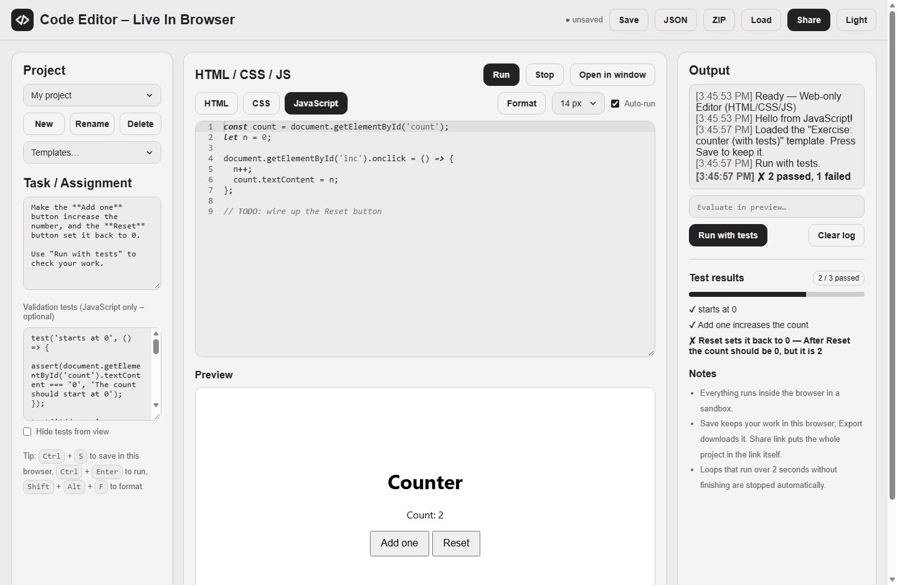
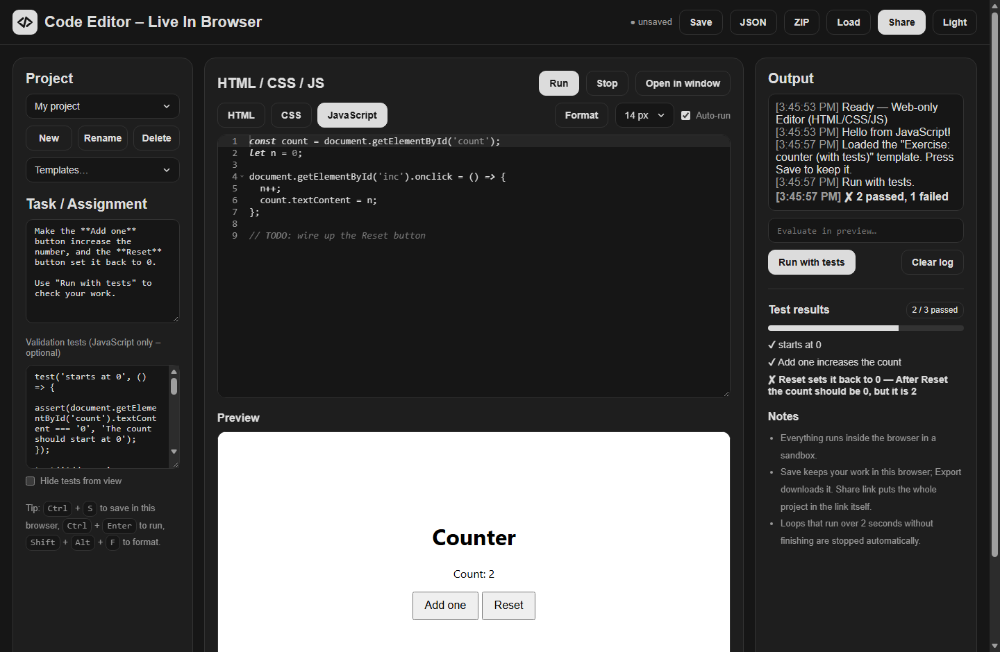

# Code Editor

A small in-browser HTML / CSS / JavaScript editor with a live preview, shareable links and **auto-graded exercises**. No build step, no backend, no account: open `index.html` and it works.

A counter exercise with two of its three tests passing, in light and dark mode:

| Light | Dark |
|---|---|
|  |  |

## What makes it different

Most "mini CodePen" projects stop at an editor and an iframe. This one is built around a classroom loop:

1. A teacher writes a **task** and a few **tests**.
2. The student writes code and presses **Run with tests**.
3. The **Test results** panel shows ✔ / ✘ per test, a score and the teacher's hint for each failure.
4. The whole exercise travels in a **single link**.

## Features

**Editing**
- Three Ace editors (HTML, CSS, JS) with tabs, line wrapping and syntax highlighting
- Emmet abbreviations (`ul>li*3` then <kbd>Tab</kbd>) in HTML and CSS
- **Format** with Prettier (loaded on first use), also <kbd>Shift</kbd>+<kbd>Alt</kbd>+<kbd>F</kbd>
- Font size control, drag-to-resize editor and preview, light and dark themes
- Falls back to plain text areas if the editor library cannot be loaded

**Running**
- Live preview, with an **Auto-run** toggle (re-renders 0.7 s after you stop typing)
- `console.log` / `warn` / `error` and uncaught errors appear in the Output panel
- A **console input** evaluates expressions inside the running preview
- **Infinite loops are stopped** after 2 s instead of freezing the tab, plus a **Stop** button
- Open the preview in its own window

**Exercises**
- Task description and JavaScript tests per project
- `test(name, fn)` and `assert(condition, message)` helpers, with a pass/fail panel and score
- Optional "hide tests from view" so students see `Hidden test 1` instead of the test code
- Starter templates, including two exercises with ready-made tests

**Projects and sharing**
- Several projects saved in your browser, with unsaved-changes warnings
- **Share** copies a link that contains the whole project (compressed, nothing is uploaded)
- Export as **JSON** (re-importable) or as a **ZIP** with `index.html`, `style.css`, `script.js`

## Quick start

Double-click `index.html`, or serve the folder:

```bash
npm start        # npx serve .
```

Run the unit tests (Node 18+, no dependencies to install):

```bash
npm test
```

## Writing tests

Tests are plain JavaScript that runs **after** the student's code, in the same page:

```js
test('Add one increases the count', () => {
  document.getElementById('inc').click();
  document.getElementById('inc').click();
  const shown = document.getElementById('count').textContent;
  assert(shown === '2', 'After two clicks the count should be 2, but it is ' + shown);
});
```

- A test fails when its function throws. The message passed to `assert` is shown as the hint.
- `test` and `assert` are read-only, so student code cannot replace them.
- Tests run in their own block, so your `const` / `let` never clash with the student's names.
- Student code and tests are separate scripts: if the student's code throws, the tests still run.
- Plain `console.assert(...)` also works; failures show up in the Output panel.

## Share links

`Share` produces `index.html#p=<token>`. The token is the project as JSON, deflate-compressed and base64url-encoded, so it never leaves the browser and needs no server. Opening a link adds the project to your saved projects.

Very large projects make very long links; the editor warns above ~8,000 characters. Use **Export JSON** for those.

## Project layout

```
index.html              page structure and the ordered list of scripts and styles
favicon.ico             classic favicon, kept at the root where browsers look first
assets/icons/           SVG favicon, 32 px PNG fallback, iOS touch icon
docs/                   README screenshots

src/
  css/                  one file per concern, loaded in this order
    tokens.css            colours, sizes and both themes as CSS variables
    base.css              reset, typography, focus ring, utilities
    layout.css            header, three-column grid, cards, footer
    controls.css          buttons, selects, text fields, tabs, badges
    logo.css              the </> mark
    editor.css            code editors and the Ace theme overrides
    preview.css           the live preview frame
    output.css            output log and console input
    results.css           test results panel
    dialog.css            confirmation / prompt dialog
    responsive.css        breakpoints (last, so they always win)
  js/
    theme-init.js         applies the saved theme before first paint
    boot.js               loads Ace, then the app scripts in order
    core/                 pure logic, no DOM (also loaded by the Node tests)
      project.js            project shape and escaping
      loop-guard.js         infinite-loop guard
      preview-doc.js        builds the preview document and test harness
      share.js              share-link encoding
      zip.js                ZIP writer and exported file list
      templates.js          starter projects
    app/                  the UI, one feature per file
      utils.js              helpers, storage, log
      dialog.js             themed confirm / prompt
      results.js            test results and preview messages
      editors.js            Ace / text-area editors and tabs
      preview.js            run, stop, auto-run, console input
      format.js             Prettier formatting
      projects.js           saved projects and unsaved-change tracking
      template-menu.js      starter template menu
      import-export.js      JSON / ZIP export, import, share links
      theme.js              theme and font size
      main.js               shortcuts and start-up

tests/
  core/                 unit tests, one file per core module
  helpers/              module loader and a fake-iframe runner
```

**Why classic scripts, not ES modules?** Browsers refuse to load modules from `file://`, and this app is meant to work when you simply double-click `index.html`. Files share one global scope instead, so the load order in `index.html` (core) and `src/js/boot.js` (app) matters: a file may only use what the files before it define.

**Adding a feature:** put DOM-free logic in `src/js/core/` (it gets unit tests for free), UI code in a new `src/js/app/` file, add it to `APP_SCRIPTS` in `boot.js` before `main.js`, and its styles in the matching `src/css/` file.

## Limits worth knowing

- **Sandbox.** The preview iframe is sandboxed without `allow-same-origin`, so student code cannot read this page's storage. It is still arbitrary code: do not use it to run code you would not run in a normal browser tab.
- **Hidden tests are not secret.** The tests travel inside the project, and anyone can untick the box or read the JSON. Hiding is a convenience, not an answer key.
- **Loop guard is best effort.** It covers `for` / `while` / `do` loops with braces. Recursion and loops without braces are not guarded, and rewritten code that fails to parse is run unchanged.
- **Async tests.** Results are collected on the page's `load` event, so tests that finish later (after a `setTimeout`) are not counted.
- **Needs a network for the extras.** Ace, Prettier and Emmet load from CDNs. Offline, or if the CDNs are blocked, the editors fall back to plain text areas and Format and Emmet are unavailable; everything else keeps working.
- **Browser support.** Compressed share links need `CompressionStream` with `deflate-raw` (Chrome 103+, Firefox 113+, Safari 16.4+); older browsers create longer, uncompressed links, and cannot open compressed ones.

## Credits

[Ace](https://ace.c9.io/) (editor), [Prettier](https://prettier.io/) (formatting) and [Emmet](https://emmet.io/) (abbreviations), all loaded from a CDN.

## License

MIT, see [LICENSE](LICENSE).
